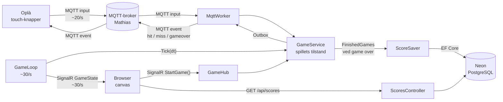

# Dataflow – sådan kommer et tryk fra Oplà til skærmen

Til fremlæggelsen 11/11 (DoD #8). Kort version: **Oplà måler, backenden bestemmer, browseren tegner.**
Kontrakten (topics og JSON) står i `MESSAGES.md` – her forklarer vi, hvad der sker undervejs.

## Ét tryk, trin for trin

| # | Hvor | Hvad sker der | Kode |
|---|---|---|---|
| 1 | Oplà | Spilleren holder op- eller ned-knappen (touch) | `Arduino/TamaPal/tilt_logic.cpp` |
| 2 | Oplà | Laver JSON `{"up":true,"down":false,"button":false,"tiltX":…,"tiltY":…,"tilt":…}` og sender til `StormLamaerne/Tamapal/opla-1/input` – højst hver 50 ms, men straks når en knap ændrer sig | `tilt_logic.cpp:130`, `net_mqtt.cpp` (`publishInput`), `settings.h` |
| 3 | Broker | Videresender beskeden til alle, der abonnerer på topic'et. Den ved intet om spillet | – |
| 4 | Backend | `MqttWorker` abonnerer på `StormLamaerne/Tamapal/+/input` (`+` = alle Oplàer), læser hvilken Oplà det er fra topic'et og laver JSON om til `OplaInput`. Ugyldig JSON ignoreres | `Backend/.../Services/MqttWorker.cs` |
| 5 | Backend | `GameService.HandleInput`: `button` starter spillet; `up`/`down` bliver til en retning: op = -1, stop = 0, ned = 1 | `Services/GameService.cs` (`HandleInput`) |
| 6 | Backend | `GameLoop` kører hele tiden: `Tick(dt)` flytter ketsjeren i retningen, flytter bolden, tjekker vægge, ketsjer, point og liv – og venter så 33 ms | `Services/GameLoop.cs`, `GameService.cs` (`Tick`) |
| 7 | Backend | Efter hvert tick sendes hele `GameState` til alle browsere via SignalR (`/gamehub`, event `GameState`) | `GameLoop.cs` |
| 8 | Browser | `network.js` gemmer bare den nyeste `GameState` | `Frontend/network.js` |
| 9 | Browser | `main.js` tegner ~60 gange i sekundet med `requestAnimationFrame`: bane, bold, ketsjer, score, liv og start-/game over-skærm | `Frontend/main.js`, `Frontend/draw.js` |

## Tilbage til Oplà

Når bolden rammer ketsjeren, ryger forbi eller spillet er slut, lægger `GameService` en besked i en kø (`Outbox`).
`MqttWorker` tømmer køen hver 20 ms og sender til `StormLamaerne/Tamapal/opla-1/event`:
`{"type":"hit"}`, `{"type":"miss"}` eller `{"type":"gameover"}`. Oplà spiller en lyd for hver (`sound_led.cpp`).
Ved game over sendes også `{"type":"happy_boost","amount":…}` til `.../pet/reward` (3 × score, højst 30) – kæledyret bliver gladere.

**Start-knappen i browseren** går den anden vej: `startGame()` → SignalR `StartGame()` → `GameHub` → `GameService.Start()`.
Spillet kan altså startes både fra Oplà (`button`) og fra browseren.

## Hvorfor sådan?

- **Serveren afgør alt** (som i Kaspers Pong-eksempel): kun ét sted har den rigtige tilstand, så Oplà og browser kan ikke blive uenige.
- **Input er en retning, ikke en position** (op/stop/ned = -1/0/1, også som hos Kasper): backenden flytter ketsjeren med fast fart, så den bevæger sig jævnt, selvom beskederne kommer ujævnt.
- **MQTT mellem Oplà og backend:** let protokol til små enheder; brokeren gør, at Oplà og backend ikke behøver kende hinandens IP.
- **SignalR mellem backend og browser:** bygger på WebSocket, så serveren kan *skubbe* data til browseren uden at browseren spørger.
- **Koordinater 0–1:** backenden kender ikke skærmens størrelse. Browseren ganger med canvas-størrelsen.
- **Tre hastigheder:** Oplà ~20/s, backend ~30/s, browser ~60/s. De er uafhængige – browseren tegner bare det nyeste, den har.

## Spørgsmål, vi kan få

- **Hvad sker der, hvis Wi-Fi/broker falder ud?** Oplà prøver at forbinde igen (timeout 1,5 s, så skærmen ikke fryser). Spillet kører videre i backenden med den sidste retning, den fik.
- **Hvad hvis backenden ikke kører?** Browseren viser "Ingen forbindelse til serveren" og prøver igen hvert 3. sekund (`network.js`).
- **Hvad hvis der kommer forkert JSON?** `MqttWorker` ignorerer beskeden og skriver en linje i loggen – spillet crasher ikke.
- **Kan der være flere spillere?** Ja (#31). Topic'et har `opla-1`/`opla-2`, og backenden lytter på `+`. `GameService` husker retning og "sidst set" for hver Oplà. Har begge sendt input inden for 3 sek, når der trykkes Start, bliver det duo: `opla-1` styrer venstre ketsjer, `opla-2` højre, og først til 5 point vinder. Ellers er det solo som før.

## Game over → databasen (#30)

| # | Hvor | Hvad sker der | Kode |
|---|---|---|---|
| 1 | Backend | `Tick` ser, at liv er 0: sætter `status = "gameover"` og lægger et `GameResult` (score, Oplà, tid i UTC) i køen `FinishedGames` | `Services/GameService.cs` |
| 2 | Backend | `ScoreSaver` tømmer køen hvert halve sekund og gemmer med EF Core i tabellen `GameResults` i Neon. Spillet venter aldrig på databasen – er den nede, skrives en linje i loggen | `Services/ScoreSaver.cs`, `Data/TamaPalDbContext.cs` |
| 3 | Browser | Henter highscore med `GET /api/scores` (top 10) eller `GET /api/scores/latest` (seneste 10). Browseren kender aldrig databasens kodeord | `Controllers/ScoresController.cs` |

Tabellen oprettes af EF Core-migrationen i `Backend/BackendTamapal/Migrations/` – ikke i hånden i Neon.

## Mangler (status 9/11)

- Highscore virker på serveren (9/11).
- 2 spillere (#31): backend og frontend er klar (10/11), mangler test med to Oplàer.
