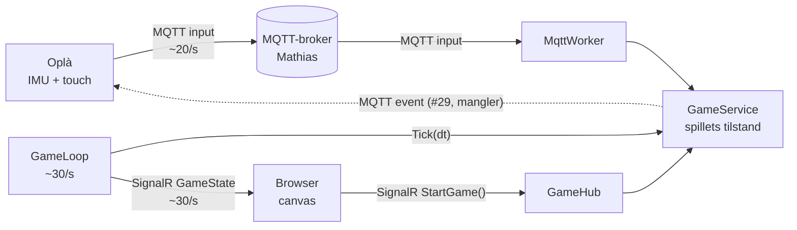

# Dataflow – sådan kommer et vip fra Oplà til skærmen

Til fremlæggelsen 11/11 (DoD #8). Kort version: **Oplà måler, backenden bestemmer, browseren tegner.**
Kontrakten (topics og JSON) står i `MESSAGES.md` – her forklarer vi, hvad der sker undervejs.

## Ét vip, trin for trin

| # | Hvor | Hvad sker der | Kode |
|---|---|---|---|
| 1 | Oplà | IMU måler hældningen. Vinklen deles med 30°, så 30° op = -1, vandret = 0, 30° ned = 1. Værdien udglattes lidt | `Arduino/TamaPal/tilt_logic.cpp` (`calculateNormalizedTilt`) |
| 2 | Oplà | Laver JSON `{"up":…,"down":…,"button":…,"tiltX":…,"tiltY":…,"tilt":0.35}` og sender til `StormLamaerne/Tamapal/opla-1/input` – højst hver 50 ms, men straks når en knap ændrer sig | `tilt_logic.cpp:130`, `net_mqtt.cpp` (`publishInput`), `settings.h` |
| 3 | Broker | Videresender beskeden til alle, der abonnerer på topic'et. Den ved intet om spillet | – |
| 4 | Backend | `MqttWorker` abonnerer på `StormLamaerne/Tamapal/+/input` (`+` = alle Oplàer) og laver JSON om til `OplaInput`. Ugyldig JSON ignoreres | `Backend/.../Services/MqttWorker.cs` |
| 5 | Backend | `GameService.HandleInput`: `button` starter spillet, og ketsjeren sættes til `paddle.y = (tilt + 1) / 2` (holdes mellem 0.1 og 0.9) | `Services/GameService.cs:35` |
| 6 | Backend | `GameLoop` kører hele tiden: `Tick(dt)` flytter bolden, tjekker vægge, ketsjer, point og liv – og venter så 33 ms | `Services/GameLoop.cs`, `GameService.cs:54` |
| 7 | Backend | Efter hvert tick sendes hele `GameState` til alle browsere via SignalR (`/gamehub`, event `GameState`) | `GameLoop.cs:29` |
| 8 | Browser | `network.js` gemmer bare den nyeste `GameState` | `Frontend/network.js:23` |
| 9 | Browser | `main.js` tegner ~60 gange i sekundet med `requestAnimationFrame`: bane, bold, ketsjer, score, liv og start-/game over-skærm | `Frontend/main.js`, `Frontend/draw.js` |

**Start-knappen i browseren** går den anden vej: `startGame()` → SignalR `StartGame()` → `GameHub` → `GameService.Start()`.
Spillet kan altså startes både fra Oplà (`button`) og fra browseren.

## Hvorfor sådan?

- **Serveren afgør alt** (som i Kaspers Pong-eksempel): kun ét sted har den rigtige tilstand, så Oplà og browser kan ikke blive uenige.
- **MQTT mellem Oplà og backend:** let protokol til små enheder; brokeren gør, at Oplà og backend ikke behøver kende hinandens IP.
- **SignalR mellem backend og browser:** bygger på WebSocket, så serveren kan *skubbe* data til browseren uden at browseren spørger.
- **Koordinater 0–1:** backenden kender ikke skærmens størrelse. Browseren ganger med canvas-størrelsen.
- **Tre hastigheder:** Oplà ~20/s, backend ~30/s, browser ~60/s. De er uafhængige – browseren tegner bare det nyeste, den har.

## Spørgsmål, vi kan få

- **Hvad sker der, hvis Wi-Fi/broker falder ud?** Oplà prøver at forbinde igen (timeout 1,5 s, så skærmen ikke fryser). Ketsjeren står stille på sidste position, spillet kører videre i backenden.
- **Hvad hvis backenden ikke kører?** Browseren viser "Ingen forbindelse til serveren" og prøver igen hvert 3. sekund (`network.js`).
- **Hvad hvis der kommer forkert JSON?** `MqttWorker` ignorerer beskeden og skriver en linje i loggen – spillet crasher ikke.
- **Kan der være flere spillere?** Topic'et har `opla-1`/`opla-2`, og backenden lytter på `+`. Men spillogikken har kun én ketsjer i dag – multiplayer er Nice to Have.

## Mangler (status 9/11)

- Backend → Oplà events `hit` / `miss` / `gameover` (#29) – stiplet pil i diagrammet.
- Highscore i databasen efter game over (#30).
